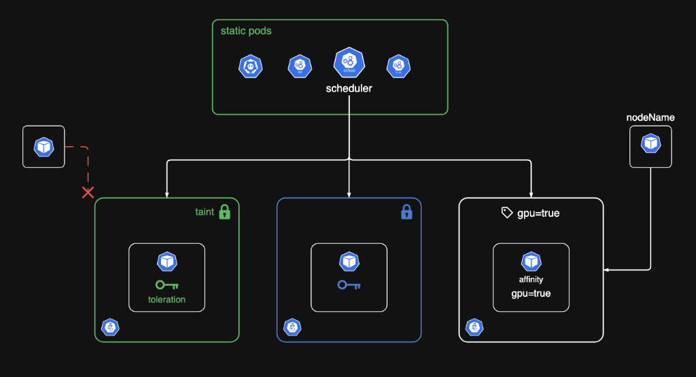

# Kubernetes 10주차 스터디정리

### 아키텍처 다이어그램

## Static Pods와 Manual Scheduling, Labels and Selectors

### 정적 파드(Static Pod)

일반 파드는 kubectl → API 서버 → etcd → 스케줄러 → kubelet 순서를 거쳐 만들어진다. 정적 파드는 이 과정 없이 kubelet이 노드의 로컬 폴더에 있는 YAML을 직접 읽어서 띄우는 파드다. 그래서 API 서버나 스케줄러가 없어도 kubelet만 살아 있으면 실행된다.

감시하는 폴더는 kubelet 설정 파일의 staticPodPath로 정해지고, 보통 /etc/kubernetes/manifests다. 여기에 YAML을 넣으면 파드가 생성되고, 수정하면 다시 만들어지고, 지우면 파드도 삭제된다.

### 컨트롤 플레인과 미러 파드

kube-apiserver, kube-controller-manager, kube-scheduler, etcd도 전부 정적 파드다. 클러스터를 처음 띄울 때는 API 서버가 아직 없으니 kubelet이 manifests 폴더를 읽어서 컨트롤 플레인부터 띄운다.

API 서버가 뜨면 kubelet이 정적 파드마다 읽기 전용 미러 파드(Mirror Pod)를 등록해서 kubectl get pods에서도 보이게 한다. 이름은 kube-scheduler-controlplane처럼 뒤에 노드 이름이 붙는다.

미러 파드는 kubectl delete로 지워도 kubelet이 다시 만든다. 정적 파드를 수정·삭제하려면 해당 노드에 접속해서 manifests 폴더의 YAML을 직접 고쳐야 한다. 컨트롤 플레인 컴포넌트가 안 뜰 때도 이 폴더의 YAML부터 확인한다.

### 수동 스케줄링(Manual Scheduling)

새로 만든 파드는 nodeName이 비어 있는 Pending 상태로 시작한다. 스케줄러가 이런 파드를 찾아서 리소스, 테인트, 어피니티 등을 보고 노드를 고른 뒤 nodeName을 채워 준다. 스케줄러가 없으면 파드는 계속 Pending으로 남는다.

스케줄러가 죽었거나 특정 노드에 바로 올리고 싶으면 spec.nodeName에 노드 이름을 직접 적으면 된다. 그러면 스케줄러를 거치지 않고 그 노드의 kubelet이 바로 파드를 띄운다.

이미 만들어진 파드의 nodeName은 kubectl edit으로 바꿀 수 없다. 이때는 Binding 오브젝트를 만들어 /api/v1/namespaces/default/pods/(파드이름)/binding 으로 POST 요청을 보내거나, 파드를 지우고 nodeName을 넣어서 다시 만든다.

### 레이블과 셀렉터

레이블은 env: prod, tier: frontend처럼 오브젝트의 metadata.labels에 붙이는 키-값 태그다. 셀렉터는 이 레이블을 조건으로 원하는 오브젝트만 골라내는 것이다.

kubectl get pods --selector env=prod 또는 줄여서 -l env=prod 로 필터링하고, --show-labels로 레이블까지 같이 볼 수 있다. Service, ReplicaSet, Deployment도 spec.selector의 레이블로 대상 파드를 찾는다.

### 레이블 vs 어노테이션 vs 네임스페이스

레이블은 분류하고 골라내기 위한 것이고, 어노테이션은 빌드 번호, 타임스탬프, 도구 설정 같은 부가 정보를 적어두는 용도다. 어노테이션은 셀렉터로 조회할 수 없다.

네임스페이스는 리소스를 아예 나눠 놓는 공간이고(RBAC, ResourceQuota도 네임스페이스 단위로 건다), 레이블은 네임스페이스와 상관없이 붙이는 태그다.

---

## Taints and Tolerations

### 테인트와 톨러레이션

테인트(Taint)는 노드에 거는 제한이고, Toleration은 그 제한을 통과할 수 있게 파드에 넣는 설정이다. 테인트가 걸린 노드에는 맞는 톨러레이션이 있는 파드만 들어갈 수 있다. GPU 노드나 DB 전용 노드처럼 특정 파드만 받고 싶을 때 쓴다.

kubectl taint nodes worker-1 gpu=true:NoSchedule 로 테인트를 걸고, kubectl taint nodes worker-1 gpu=true:NoSchedule- 처럼 끝에 -를 붙이면 제거된다.

### 주의 — 톨러레이션은 배치를 보장하지 않는다

톨러레이션은 "들어가도 된다"는 허가일 뿐 "그 노드로 가라"는 뜻이 아니다. 테인트가 없는 다른 노드가 있으면 그쪽에 배치될 수도 있다. 특정 노드에 확실히 보내려면 노드 어피니티를 같이 써야 한다.

### Taint Effect 3가지

| Effect | 새 파드 | 이미 실행 중인 파드 |
|--------|---------|---------------------|
| NoSchedule | 톨러레이션 없으면 배치 안 됨 | 영향 없음 |
| PreferNoSchedule | 되도록 피하지만, 갈 곳이 없으면 배치 | 영향 없음 |
| NoExecute | 톨러레이션 없으면 배치 안 됨 | 톨러레이션 없으면 쫓겨남(evict) |

NoExecute에서 톨러레이션에 tolerationSeconds를 주면 바로 쫓겨나지 않고 그 시간 동안 머물다가 나간다.

### 파드 YAML에 톨러레이션 넣기

spec.tolerations 아래에 key, operator, value, effect를 적는다. operator가 Equal이면 key, value, effect가 테인트와 정확히 같아야 하고, Exists면 value 없이 key(와 effect)만 맞으면 된다.

### 왜 컨트롤 플레인 노드에는 파드가 안 뜨는가

컨트롤 플레인 노드에는 기본으로 node-role.kubernetes.io/control-plane:NoSchedule 테인트가 걸려 있어서 일반 파드는 워커 노드에만 배치된다. 9주차 DaemonSet에서 마스터 노드에 파드가 안 떴던 것도 이 때문이다. 마스터 노드에도 띄우려면 이 테인트에 대한 톨러레이션을 넣어야 한다.

---

## Kubernetes Node Affinity

### nodeSelector vs Node Affinity

nodeSelector는 disktype=ssd처럼 레이블이 정확히 일치하는 노드만 고를 수 있다. "A 또는 B", "A가 아닌 노드", "이 키가 있는 노드" 같은 조건은 쓸 수 없다. 노드 어피니티는 In, NotIn, Exists, DoesNotExist 같은 연산자로 이런 조건을 표현할 수 있다.

### Taint vs Node Affinity

테인트는 노드가 원치 않는 파드를 밀어내는 것이고, 노드 어피니티는 파드가 원하는 노드를 골라서 가는 것이다. 그래서 전용 노드를 만들 때는 테인트로 다른 파드를 막고, 어피니티로 원하는 파드를 그 노드로 보내는 식으로 둘을 같이 쓴다.

### required vs preferred

requiredDuringSchedulingIgnoredDuringExecution은 필수 조건(hard)이다. 조건에 맞는 노드가 없으면 파드는 어디에도 배치되지 않고 Pending으로 남는다.

preferredDuringSchedulingIgnoredDuringExecution은 선호 조건(soft)이다. weight로 가중치를 줘서 조건에 맞는 노드를 우선 고르지만, 없으면 다른 노드에라도 배치한다.

둘 다 뒤에 붙은 IgnoredDuringExecution은 이미 실행 중인 파드는 건드리지 않는다는 뜻이다. 파드가 뜬 뒤에 노드 레이블이 바뀌어도 파드는 그대로 있다.
