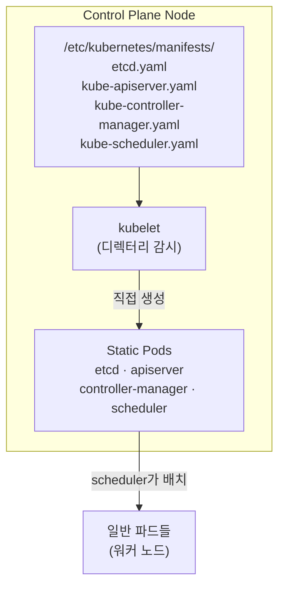
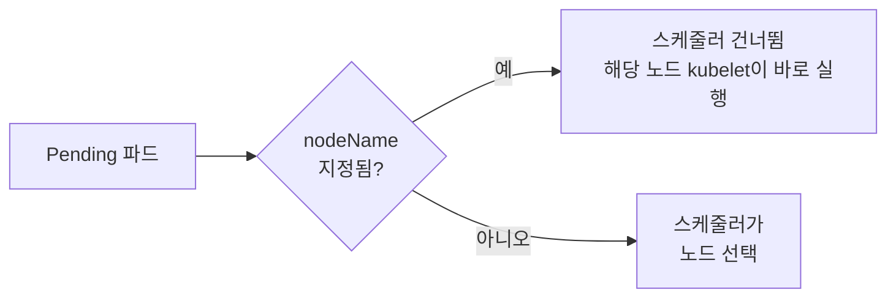
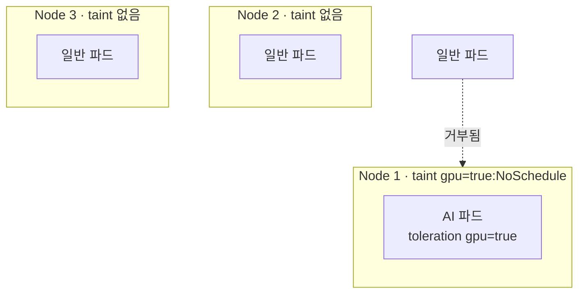
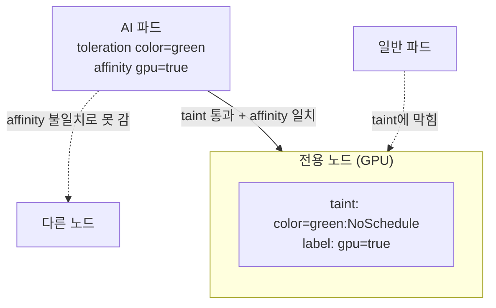

# Week 10 — DAY 13, 14, 15 학습 정리

정리: 김민성
강의: Tech Tutorials with Piyush — CKA Full Course
범위: DAY 13 (Static Pods, Manual Scheduling, Labels & Selectors) / DAY 14 (Taints & Tolerations, nodeSelector) / DAY 15 (Node Affinity)

이번 주의 주제는 하나로 묶인다. **"파드는 어느 노드에 배치되는가, 그리고 그걸 어떻게 통제하는가."** 스케줄러가 무엇이고 스케줄러 없이도 파드가 뜨는 경우는 언제인지에서 시작해, 노드가 파드를 거부하는 방법(taint), 파드가 노드를 고르는 방법(nodeSelector, node affinity)까지 이어진다.

---

## DAY 13 — Static Pods, Manual Scheduling, Labels & Selectors

### 스케줄러의 역할 복습

파드 생성 요청이 들어오면 이런 순서로 처리된다.

```
kubectl → API Server → etcd에 엔트리 생성
       → Scheduler가 배치할 노드 결정 → API Server
       → 해당 노드의 kubelet이 파드 생성 → API Server → etcd 갱신 → 사용자에게 응답
```

여러 컴포넌트가 관여하지만 **"어느 노드에 놓을지"를 결정하는 건 스케줄러**다.

### 닭이 먼저냐 달걀이 먼저냐 — Static Pod

스케줄러도 컨트롤 플레인 컴포넌트이고, **파드로 실행된다.**

```bash
kubectl get pods -n kube-system | grep scheduler
# kube-scheduler-cka-cluster3-control-plane   1/1   Running
```

그렇다면 의문이 생긴다. **파드를 배치하는 스케줄러 자신은 누가 배치하나?**

답이 **Static Pod**다.

- 컨트롤 플레인 컴포넌트(API Server, etcd, Controller Manager, Scheduler)는 **static pod**로 실행된다
- static pod는 **스케줄러가 관리하지 않는다**
- 대신 **kubelet이 특정 디렉터리를 감시**하다가, 거기에 매니페스트가 있으면 직접 파드를 띄운다



기본 디렉터리는 **`/etc/kubernetes/manifests`** 다.

### 실습 — 스케줄러를 꺼보기

**kind의 노드는 도커 컨테이너**라서 SSH가 아니라 `docker exec` 로 들어간다. 클라우드나 VMware 같은 환경이라면 SSH(윈도우면 RDP)로 접속한다.

```bash
docker ps | grep control-plane
docker exec -it cka-cluster3-control-plane bash

ls /etc/kubernetes/manifests
# etcd.yaml  kube-apiserver.yaml  kube-controller-manager.yaml  kube-scheduler.yaml
```

스케줄러 매니페스트를 다른 곳으로 옮기면,

```bash
mv /etc/kubernetes/manifests/kube-scheduler.yaml /tmp/
```

kubelet이 이를 감지하고 **스케줄러 파드가 사라진다.** 이때 클러스터에는 이런 일이 생긴다.

- 컨트롤 플레인 전체가 죽는 건 아니다. **스케줄러가 하던 일만 멈춘다**
- **이미 떠 있는 파드는 계속 실행된다** (죽지 않는 한)
- **새로 만드는 파드는 `Pending` 에서 멈춘다**

```bash
kubectl run nginx --image=nginx
kubectl get pods
# nginx   0/1   Pending

kubectl describe pod nginx
# Node: <none>   ← 노드가 비어 있음. 에러 이벤트도 없음
```

에러 메시지가 따로 없다는 점이 포인트다. **`Node` 가 비어 있고 Pending이면 스케줄러 문제를 의심**해야 한다.

매니페스트를 다시 돌려놓으면,

```bash
mv /tmp/kube-scheduler.yaml /etc/kubernetes/manifests/
```

kubelet이 스케줄러를 다시 띄우고, 대기 중이던 파드도 바로 스케줄된다.

> 컨트롤 플레인 컴포넌트를 재시작하거나 트러블슈팅할 때 **가장 먼저 볼 곳이 이 디렉터리**다.

### Manual Scheduling — nodeName

스케줄러가 하는 일을 좀 더 정확히 말하면 이렇다. **Pending 상태의 파드를 계속 훑으면서, `nodeName` 이 지정되지 않은 파드를 찾아 노드를 배정**한다.



`nodeName` 이 이미 있으면 스케줄러는 "내 일이 아니다"라고 보고 넘어간다. 이게 **수동 스케줄링**이다.

```yaml
apiVersion: v1
kind: Pod
metadata:
  name: nginx
spec:
  nodeName: cka-cluster3-worker     # 노드를 직접 지정
  containers:
    - name: nginx
      image: nginx
```

**스케줄러를 꺼둔 상태에서** 이 파드를 만들면 **정상적으로 Running이 되고, 지정한 노드에 배치된다.** 스케줄러가 전혀 관여하지 않았다는 증거다.

> 이미 특정 노드에 배치된 파드는 **다른 노드로 옮길 수 없다.** 삭제하고 다시 만들어야 한다.

### Labels & Selectors 다시 보기

디플로이먼트 매니페스트에는 라벨이 세 군데 나온다. 각각 역할이 다르다.

```yaml
apiVersion: apps/v1
kind: Deployment
metadata:
  labels:
    env: demo            # ① 디플로이먼트 자신의 라벨
spec:
  selector:
    matchLabels:
      env: demo          # ③ 어떤 파드를 관리할지 고르는 조건
  template:
    metadata:
      labels:
        env: demo        # ② 파드의 라벨
```

③의 셀렉터가 ②의 파드 라벨과 매칭되어서, 디플로이먼트가 그 파드들을 관리한다.

라벨은 여러 개 붙일 수 있고, 셀렉터로 필터링한다.

```bash
kubectl get pods --show-labels
kubectl get pods --selector tier=frontend     # 또는 -l tier=frontend
kubectl get pods --selector tier=backend
```

파드가 수백 개일 때 "프론트엔드 파드만" 같은 조회를 이렇게 한다.

### Annotation은 라벨과 다르다

`kubectl edit` 로 오브젝트를 열어보면 `metadata.annotations` 가 있다. 예를 들어 `kubectl.kubernetes.io/last-applied-configuration` 에는 **이전에 apply한 설정 전체**가 들어 있다. 컨트롤러가 변경이나 롤백을 처리할 때 참고하는 정보다.

| | Label | Annotation |
| --- | --- | --- |
| 목적 | **식별·그룹핑·선택** | **부가 정보 저장** |
| 셀렉터로 조회 | 가능 | 불가능 |
| 예시 | `tier=frontend` | 마지막 적용 설정, 생성 정보 |

### Label과 Namespace의 차이

| | Namespace | Label |
| --- | --- | --- |
| 성격 | **논리적 격리** | **태그** |
| 목적 | 실수 방지, 권한 분리, 보안 | 필터링, 그룹핑 |

강사의 비유: 쇼핑몰의 상품에는 평점, 카테고리, 가격 같은 **여러 라벨**이 붙어 있고, 왼쪽 **필터**로 원하는 것만 고른다. 그 필터가 셀렉터다.

---

## DAY 14 — Taints & Tolerations, nodeSelector

### 기본 개념

| | 어디에 거나 | 의미 |
| --- | --- | --- |
| **Taint** | **노드** | "이 조건을 견딜 수 있는 파드만 받겠다" |
| **Toleration** | **파드** | "나는 이 taint를 견딜 수 있다" |

예시 상황: 노드 1에는 GPU가 달려 있어서 **AI 워크로드 전용**으로 쓰고 싶다.



toleration이 없는 일반 파드는 노드 1에 거부되고 다른 노드로 간다. toleration이 있는 AI 파드만 노드 1에 들어갈 수 있다.

> **가장 중요한 포인트**: taint/toleration은 **노드가 받을 파드를 고르는 것**이지, **파드를 특정 노드로 보내는 것이 아니다.** toleration이 있는 AI 파드도 taint 없는 노드 2, 3으로 갈 수 있다. "그 노드에만 간다"는 **보장이 없다.**

### Effect 세 가지

| Effect | 동작 |
| --- | --- |
| `NoSchedule` | **새로 스케줄되는 파드에만** 적용. 기존 파드는 그대로 |
| `PreferNoSchedule` | 가능하면 피하지만 **보장하지 않음** |
| `NoExecute` | **기존 파드까지** 적용. toleration 없는 기존 파드는 **쫓겨남(evict)** |

### 실습 — taint 걸기

```bash
kubectl taint node cka-cluster3-worker gpu=true:NoSchedule
kubectl taint node cka-cluster3-worker2 gpu=true:NoSchedule

kubectl describe node cka-cluster3-worker | grep Taints
# Taints: gpu=true:NoSchedule
```

> 대소문자 주의. `noschedule` 이 아니라 **`NoSchedule`** 이다. 강사도 여기서 한 번 틀렸다.

워커 노드 두 개에 taint를 건 상태에서 일반 파드를 만들면,

```bash
kubectl run nginx --image=nginx
kubectl get pods
# nginx   0/1   Pending

kubectl describe pod nginx
```

```
0/3 nodes are available:
  1 node(s) had untolerated taint {node-role.kubernetes.io/control-plane: },
  2 node(s) had untolerated taint {gpu: true}.
```

**세 노드 모두 갈 곳이 없다.** 컨트롤 플레인에는 원래 taint가 있고, 워커 두 대에는 방금 건 taint가 있다.

> 이게 **DAY 12에서 DaemonSet 파드가 컨트롤 플레인 노드에 안 뜬 이유**다. 컨트롤 플레인 노드에는 기본으로 `node-role.kubernetes.io/control-plane:NoSchedule` taint가 걸려 있다. 사용자 워크로드가 컨트롤 플레인에 올라가지 못하게 막는 장치다.

### 실습 — toleration 추가

toleration은 **명령줄로 추가할 수 없어서** dry-run으로 YAML을 뽑아 수정한다.

```bash
kubectl run redis --image=redis --dry-run=client -o yaml > redis.yaml
```

`spec` 아래, `containers` 와 **같은 레벨**에 추가한다.

```yaml
spec:
  containers:
    - name: redis
      image: redis
  tolerations:
    - key: "gpu"
      operator: "Equal"
      value: "true"
      effect: "NoSchedule"
```

```bash
kubectl apply -f redis.yaml
kubectl get pods -o wide
# redis   Running   cka-cluster3-worker   ← taint를 견뎌서 배치됨
# nginx   Pending                         ← 여전히 대기
```

### taint 제거

명령 끝에 **하이픈(`-`)** 을 붙인다.

```bash
kubectl taint node cka-cluster3-worker2 gpu=true:NoSchedule-
```

taint가 사라지자 Pending이던 nginx 파드가 **worker2에 바로 스케줄된다.**

### nodeSelector — 파드가 노드를 고른다

taint/toleration이 "노드가 파드를 거부"하는 방식이라면, nodeSelector는 반대로 **"파드가 갈 노드를 고르는"** 방식이다. 노드 라벨을 기준으로 한다.

```yaml
spec:
  containers:
    - name: nginx
      image: nginx
  nodeSelector:
    gpu: "false"
```

매칭되는 라벨을 가진 노드가 없으면 Pending이 된다.

```
0/3 nodes are available:
  1 node(s) had untolerated taint {node-role.kubernetes.io/control-plane: },
  2 node(s) didn't match Pod's node affinity/selector.
```

노드에 라벨을 붙이면 바로 스케줄된다. 파드에 라벨 붙이는 것과 같은 명령이다.

```bash
kubectl label node cka-cluster3-worker gpu=false
kubectl get nodes --show-labels
```

### taint/toleration vs nodeSelector

| | Taint & Toleration | nodeSelector |
| --- | --- | --- |
| 누가 결정하나 | **노드**가 받을 파드를 결정 | **파드**가 갈 노드를 결정 |
| 성격 | 제한(restriction) | 선택(selection) |
| 기준 | taint 키·값·effect | 노드 라벨 |

nodeSelector의 한계도 있다. **표현식을 쓸 수 없고, OR나 AND 같은 여러 조건을 걸 수 없다.** 정확히 일치하는 라벨만 된다. 이 한계를 푸는 게 DAY 15의 node affinity다.

---

## DAY 15 — Node Affinity

### 왜 필요한가

taint/toleration에는 두 가지 한계가 있었다.

- 여러 조건이나 표현식을 쓸 수 없다
- 파드가 특정 노드로 **간다는 보장이 없다** (taint 없는 다른 노드로 갈 수도 있음)

node affinity는 **라벨 + 연산자**로 이 문제를 푼다.

### 연산자 예시

노드 라벨이 `disk=HDD`, `disk=SSD`, `disk=SSD` 인 노드 세 개가 있다고 하자.

| 파드의 affinity | 갈 수 있는 노드 |
| --- | --- |
| `disk NotIn [SSD]` | HDD 노드 |
| `disk In [SSD]` | SSD 노드 두 개 중 하나 |
| `disk In [SSD, HDD]` | 셋 중 아무 데나 |

nodeSelector로는 불가능했던 **"이거나 저거(In)", "이게 아닌 것(NotIn)"** 같은 조건을 쓸 수 있다. 연산자에는 `In`, `NotIn`, `Exists`, `DoesNotExist`, `Gt`, `Lt` 가 있다.

### 두 가지 속성 — 이름이 문장처럼 길다

```
requiredDuringSchedulingIgnoredDuringExecution
preferredDuringSchedulingIgnoredDuringExecution
```

길어 보이지만 **앞부분과 뒷부분으로 나눠 읽으면** 쉽다.

| 부분 | 의미 |
| --- | --- |
| **required**DuringScheduling | 조건에 맞는 노드가 **반드시** 있어야 스케줄. 없으면 **Pending** |
| **preferred**DuringScheduling | 조건에 맞는 노드를 **선호**. 없어도 **아무 노드에나 스케줄** |
| IgnoredDuringExecution | **이미 실행 중인 파드는 영향 없음.** 나중에 노드 라벨이 바뀌어도 쫓겨나지 않음 |

선택 기준은 이렇다.

- **"이 노드에만 가야 한다"** 가 중요하면 → `required`
- **"일단 뜨는 게 중요하고, 가능하면 저 노드면 좋겠다"** 면 → `preferred`

### required 매니페스트

```yaml
spec:
  containers:
    - name: redis
      image: redis
  affinity:
    nodeAffinity:
      requiredDuringSchedulingIgnoredDuringExecution:
        nodeSelectorTerms:
          - matchExpressions:
              - key: disktype
                operator: In
                values:
                  - ssd
```

> 강사가 여기서 실수했다. `affinity` 바로 아래 **`nodeAffinity` 를 빼먹어서** `unknown field` 에러가 났다. affinity에는 nodeAffinity 외에 podAffinity, podAntiAffinity도 있어서 **어떤 affinity인지 반드시 명시**해야 한다.

`affinity` 는 `containers` 와 같은 레벨, 즉 `spec` 바로 아래에 둔다. 컨테이너 이미지나 이미지 pull 방식처럼 컨테이너 자체에 관한 설정이 아니면 대부분 `spec` 아래로 간다.

매칭되는 노드가 없으면 Pending이고, 라벨을 붙이면 바로 스케줄된다.

```bash
kubectl label node cka-cluster3-worker disktype=ssd
kubectl get pods -o wide     # worker에 배치됨
```

### preferred 매니페스트

`preferred` 는 구조가 조금 다르다. **`weight` 와 `preference`** 가 필요하다.

```yaml
affinity:
  nodeAffinity:
    preferredDuringSchedulingIgnoredDuringExecution:
      - weight: 1
        preference:
          matchExpressions:
            - key: disktype
              operator: In
              values:
                - hdd
```

`hdd` 라벨을 가진 노드가 **없는데도 파드가 Running이 된다.** 선호 조건일 뿐이기 때문이다.

### IgnoredDuringExecution 확인

노드에서 라벨을 지워도 **이미 떠 있는 파드는 그대로 실행**된다. 앞으로 새로 스케줄되는 파드에만 영향을 준다.

```bash
kubectl label node cka-cluster3-worker disktype-    # 라벨 삭제
kubectl get pods                                    # 기존 파드 Running 유지
```

### Exists 연산자

값은 보지 않고 **해당 키를 가진 라벨이 있는지만** 확인한다. `values` 를 쓰지 않는다.

```yaml
- key: disktype
  operator: Exists
```

값이 비어 있는 라벨도 매칭된다.

```bash
kubectl label node cka-cluster3-worker disktype=
# disktype= (값 없음) → Exists 조건 충족 → 스케줄됨
```

> node anti-affinity는 CKA 범위가 아니라서 강의에서 따로 다룬다고 했다.

### Affinity와 Taint를 함께 쓰는 이유

둘 중 하나만으로는 "이 노드는 **이 파드만** 받고, 이 파드는 **이 노드에만** 간다"를 완성할 수 없다.

- **Taint/Toleration만** 쓰면 → 노드는 원치 않는 파드를 막지만, 원하는 파드가 **다른 노드로 샐 수 있다**
- **Node Affinity만** 쓰면 → 파드는 원하는 노드로 가지만, **다른 파드도 그 노드에 들어올 수 있다**



**둘을 합치면** 양쪽이 다 막힌다.

- taint가 **원치 않는 파드를 노드에서 밀어내고**
- affinity가 **원하는 파드를 그 노드로 끌어온다**

GPU 노드, AI/ML 전용 노드, 데이터 웨어하우스용 고성능 노드처럼 **특정 워크로드 전용 노드**를 만들 때 이 조합을 쓴다.

---

## 세 강의 정리 — 파드 배치를 통제하는 방법 총정리

| 방법 | 누가 결정 | 스케줄러 거침 | 보장 | 표현식 |
| --- | --- | --- | --- | --- |
| **nodeName** | 사용자가 노드 직접 지정 | **아니오** | 지정 노드로 감 | 없음 |
| **nodeSelector** | 파드가 노드 선택 | 예 | 일치 노드로만 | 정확히 일치만 |
| **Node Affinity** | 파드가 노드 선택 | 예 | required면 보장 | In, NotIn, Exists 등 |
| **Taint & Toleration** | 노드가 파드 거부 | 예 | **보장 안 함** (다른 노드로 갈 수 있음) | 없음 |
| **Static Pod** | kubelet이 직접 실행 | **아니오** | 해당 노드에서만 | — |

### 자주 쓰는 명령어

```bash
# Static Pod
docker exec -it <control-plane-node> bash       # kind (일반 환경은 ssh)
ls /etc/kubernetes/manifests

# 라벨
kubectl get pods --show-labels
kubectl get pods -l tier=frontend
kubectl label node <node> disktype=ssd
kubectl label node <node> disktype-             # 라벨 삭제

# Taint
kubectl taint node <node> gpu=true:NoSchedule
kubectl taint node <node> gpu=true:NoSchedule-  # taint 삭제
kubectl describe node <node> | grep Taints

# toleration / affinity는 YAML로
kubectl run <name> --image= --dry-run=client -o yaml > pod.yaml
```
