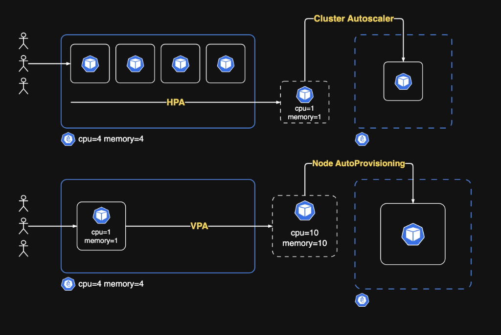

# Kubernetes 11주차 요약 정리

### 아키텍처 다이어그램

## 1. Kubernetes Requests and Limits

### 자원 요청(Requests)과 제한(Limits)의 기본 개념

쿠버네티스에서 파드는 하나 이상의 컨테이너를 감싸는 배포 단위이며, 컨테이너 내부에서는 실제 프로세스가 연산을 수행하기 위해 노드의 물리적 CPU와 메모리 자원을 지속적으로 소비한다. 만약 사용자가 파드를 정의할 때 컨테이너가 사용할 자원의 양을 명시하지 않으면 파드는 노드에 남아있는 모든 자원을 무제한으로 사용하려고 시도할 수 있다. 이러한 무분별한 자원 잠식을 방지하고 안정적인 클러스터 운영을 보장하기 위해 쿠버네티스는 컨테이너 스펙 내에 resources 필드를 두고 requests(요청)와 limits(제한) 두 가지 기준을 제공한다.

요청값(requests)은 파드가 정상적으로 기동되기 위해 최소한으로 보장받아야 하는 자원의 양을 의미한다. 쿠버네티스 스케줄러는 노드를 탐색할 때 각 노드의 실제 실시간 자원 사용량이 아니라, 이미 노드에 배치된 파드들의 자원 요청값 합계를 기준으로 남은 여유 공간을 계산한다. 반면 제한값(limits)은 컨테이너가 실행 중에 사용할 수 있는 자원의 절대적인 최대 상한선이다. 컨테이너 내부 프로세스에 부하가 집중되더라도 사전에 설정된 제한값을 초과하여 호스트 노드나 인접한 다른 파드의 자원을 침범하지 못하도록 강제 격리하는 역할을 한다.

### 스케줄러의 노드 선정과 요청값의 역할

신규 파드가 생성되면 kube-scheduler는 클러스터 내 모든 노드의 총 용량에서 이미 예약된 요청값들의 합을 차감하여 파드를 수용할 수 있는 최적의 노드를 탐색한다. 만약 클러스터 내 모든 노드의 미할당 자원이 파드가 요구하는 CPU나 메모리 요청값보다 적다면, 스케줄러는 파드를 어떤 노드에도 배치하지 못하고 스케줄링을 보류한다.

이 경우 파드는 Pending 상태로 머무르게 되며, kubectl describe pod 명령으로 상세 상태를 조회하면 Insufficient memory 또는 Insufficient cpu 경고 메시지가 이벤트 로그에 기록된다. 즉 요청값은 스케줄러가 파드를 배치할 수 있는 노드가 존재하는지 판단하는 배타적 기준으로 동작하므로, 노드의 물리적 스펙을 초과하는 과도한 요청값을 지정하지 않도록 주의해야 한다.

### 압축 가능한 자원과 압축 불가능한 자원의 초과 동작 차이

쿠버네티스에서 CPU와 메모리는 자원의 본질적인 물리적 특성이 서로 다르기 때문에 제한값을 초과했을 때 시스템이 대응하는 방식에 큰 차이가 있다. CPU는 시간 단위로 분할하여 할당을 조절할 수 있는 압축 가능한(Compressible) 자원이다. 컨테이너가 지정된 CPU 제한값을 초과하여 연산을 시도하면, 리눅스 커널의 CFS 스케줄러가 해당 컨테이너의 CPU 사용 시간을 강제로 지연시키는 CPU Throttling을 적용한다. 이로 인해 애플리케이션의 처리 속도가 느려지고 응답 지연이 발생할 수는 있지만 컨테이너 프로세스가 강제 종료되지는 않는다.

반면 메모리는 프로세스가 데이터를 연속적으로 점유해야 하는 압축 불가능한(Incompressible) 자원이다. 컨테이너가 사전에 설정된 메모리 제한값을 초과하여 메모리 할당을 요청하면, 리눅스 커널의 OOM Killer(Out Of Memory Killer)가 즉시 개입하여 해당 컨테이너 프로세스를 강제로 강제 종료시킨다. 이때 파드는 OOMKilled 상태로 비정상 종료되며 컨테이너 재시작 정책에 따라 재기동을 시도하게 된다. 단일 컨테이너의 메모리 누수나 트래픽 폭증이 전체 노드의 붕괴로 이어지는 것을 막기 위해, 시스템 전체가 다운되는 대신 해당 파드만을 선제적으로 희생시키는 보호 메커니즘이다.

### 메트릭 서버와 실시간 자원 모니터링

파드와 노드의 실제 자원 소비량을 관측하기 위해서는 클러스터 내에 Metrics Server 컴포넌트가 활성화되어 있어야 한다. 메트릭 서버는 각 노드의 kubelet에 내장된 cAdvisor로부터 CPU 및 메모리 사용량 지표를 수집하여 쿠버네티스 메트릭 API(metrics.k8s.io)로 노출한다.

클러스터 관리자는 kubectl top node 명령을 통해 각 노드의 총 자원 대비 현재 소비 비율을 파악할 수 있으며, kubectl top pod 명령으로 개별 파드가 실제로 소모하고 있는 밀리코어(m) 단위의 CPU와 메비바이트(Mi) 단위의 메모리를 실시간으로 모니터링할 수 있다. 이를 통해 비정상적인 메모리 누수가 발생하는 파드를 조기에 식별하고 적절한 요청값과 제한값을 도출할 수 있다.

---

## 2. Kubernetes Autoscaling

### 수동 스케일링의 한계와 오토스케일링의 필요성

과거의 인프라 운영 방식이나 기본적인 쿠버네티스 디플로이먼트에서는 관리자가 replicas 필드에 원하는 파드 복제본 수를 수동으로 명시하여 트래픽을 처리했다. 하지만 24시간 실시간으로 급변하는 사용자 접속량이나 비즈니스 이벤트에 맞춰 엔지니어가 수작업으로 파드 수를 변경하는 것은 불가능에 가깝다. 트래픽이 급증할 때 신속하게 대응하지 못하면 서버 병목 현상과 장애가 발생하고, 반대로 트래픽이 적은 심야 시간에 여유 자원을 회수하지 않으면 불필요한 인프라 비용이 낭비된다.

이러한 수동 운영의 병목을 해결하고 서비스의 고가용성과 비용 효율성을 동시에 확보하기 위해 쿠버네티스는 부하량에 따라 시스템이 스스로 자원 규모를 늘리고 줄이는 오토스케일링(Autoscaling) 체계를 지원한다.

### 세 가지 오토스케일링 유형: HPA, VPA, CA

쿠버네티스의 오토스케일링은 대상과 확장 방향에 따라 세 가지 계층으로 구분된다.

첫째는 HPA(Horizontal Pod Autoscaler)로, 파드의 복제본 개수를 수평적으로 늘리거나 줄이는 수평 파드 오토스케일러다. 트래픽 부하가 증가하면 동일한 애플리케이션 파드를 복제하여 병렬로 처리할 수 있도록 Scale-Out하고, 부하가 감소하면 추가되었던 파드를 순차적으로 종료하는 Scale-In을 수행한다. 웹 프론트엔드나 무상태(Stateless) API 서버처럼 상태를 공유하지 않는 서비스에 가장 이상적인 방식이다.

둘째는 VPA(Vertical Pod Autoscaler)로, 파드의 개수를 유지하는 대신 파드 내부 컨테이너의 CPU 및 메모리 요청값과 제한값 크기 자체를 위아래로 조절하는 수직 파드 오토스케일러다. VPA는 데이터베이스나 상태를 지닌 워크로드처럼 인스턴스를 함부로 여러 개로 복제하기 어려운 환경에 적합하다. 다만 기존 파드의 스펙을 변경하는 과정에서 컨테이너 재시작과 일시적인 서비스 단절이 수반될 수 있으므로 운영 환경에서 신중한 설계가 요구된다.

셋째는 CA(Cluster Autoscaler)로, 파드가 아닌 쿠버네티스 클러스터 자체의 워커 노드 개수를 자동으로 증감시키는 노드 레벨 오토스케일러다. HPA 등으로 인해 파드 수가 급증하여 기존 워커 노드들의 자원이 고갈되면 신규 파드들이 Pending 상태에 빠지게 되는데, CA는 이를 감지하여 AWS, GCP, Azure 등 클라우드 인프라 제공자에게 요청해 새로운 VM 인스턴스를 자동으로 프로비저닝한다. 반대로 오랜 시간 동안 유휴 자원이 많은 노드가 발견되면 파드를 다른 노드로 비운 후 노드를 안전하게 삭제하여 비용을 절감한다.

### HPA(Horizontal Pod Autoscaler)의 동작 메커니즘과 계산 공식

HPA는 쿠버네티스 컨트롤러 매니저 내부의 제어 루프로 동작하며, 주기적으로 메트릭 서버에 질의하여 대상 파드들의 평균 자원 사용률을 수집한다. 관리자가 지정한 목표 사용률(예를 들어 평균 CPU 사용률 50%)과 현재 측정된 실제 사용률을 비교하여 필요한 복제본 수를 자동으로 산출한다.

HPA의 기본 계산 공식은 현재 복제본 수에 현재 측정된 메트릭 값을 곱한 후 이를 목표 메트릭 값으로 나눈 뒤 올림 처리하는 방식을 취한다. 예를 들어 현재 1개의 파드가 실행 중인데 목표 CPU 사용률이 50%인 상황에서 실제 사용률이 100%까지 치솟았다면, HPA는 계산식에 따라 즉시 파드를 2개로 증설하여 부하를 분산시킨다. 관리자는 HPA 설정 시 최소 파드 수(minReplicas)와 최대 파드 수(maxReplicas)를 지정하여 예상치 못한 무한 증설이나 인프라 과부하를 방지할 수 있다.

### 부하 테스트를 통한 HPA 스케일링 실습과 쿨다운(Cooldown)

실습 환경에서는 PHP 기반 아파치 웹 서버 디플로이먼트를 배포한 뒤, kubectl autoscale deployment 명령을 통해 목표 CPU 50%, 최소 파드 1개, 최대 파드 10개 조건의 HPA를 구성한다. 이후 별도의 비지박스(busybox) 컨테이너에서 무한 루프로 웹 요청을 전송하는 로드 제너레이터(Load Generator)를 구동하여 인위적으로 CPU 부하를 발생시킨다.

부하가 유입되어 CPU 사용률이 임계치를 초과하면 HPA 컨트롤러가 이를 감지하여 파드 복제본 수를 5개에서 7개까지 가파르게 확장하며 부하를 분산시킨다. 부하 발생 프로세스를 중단하면 CPU 사용률은 수 초 내로 0% 가까이 떨어지지만 파드가 즉각적으로 줄어들지는 않는다. 이는 트래픽의 일시적 출렁임으로 인해 파드가 생성과 삭제를 반복하는 플래핑(Flapping) 현상을 방지하기 위해 쿠버네티스가 스케일 다운 안정화 윈도우(기본 5분 쿨다운)를 두기 때문이다. 유예 시간이 지나 부하 감소가 안정적으로 확인되면 HPA는 파드 수를 최초 설정했던 최소치인 1개로 안전하게 축소한다.

---

## 3. Kubernetes Health Probes

### 헬스 프로브의 개념과 자가 치유(Self-Healing)

운영 환경에서 애플리케이션은 데드락(교착 상태), 무한 루프, 메모리 고갈, 외부 데이터베이스와의 일시적 연결 단절 등 다양한 이유로 정상 응답을 하지 못하는 교착 상태에 빠질 수 있다. 과거에는 엔지니어가 모니터링 알람을 확인하고 수동으로 서버에 접속해 재시작해야 했지만, 쿠버네티스는 컨테이너의 내부 상태를 스스로 진단하고 복구하는 헬스 프로브(Health Probes)를 통해 강력한 자가 치유 능력을 구현한다.

프로브는 각 노드의 kubelet이 주기적으로 컨테이너 내부를 검사(진단)하고 그 결과에 따라 컨테이너를 재시작하거나 서비스 트래픽 수신 대상에서 격리하는 능동적인 헬스 체크 메커니즘이다.

### 라이브니스 프로브(Liveness Probe)의 동작 원리

라이브니스 프로브는 컨테이너 애플리케이션 프로세스가 살아있고 정상적으로 실행 중인지를 지속해서 감시한다. 만약 애플리케이션 내부에서 치명적인 에러가 발생하여 진단 요청에 응답하지 못하거나 실패가 누적되면, kubelet은 해당 컨테이너가 복구 불가능한 상태에 빠졌다고 판단한다.

이때 kubelet은 해당 컨테이너 프로세스를 강제로 종료하고 파드의 restartPolicy 설정에 따라 새로운 컨테이너로 재시작한다. 즉 라이브니스 프로브는 재시작만으로 쉽게 복구될 수 있는 일시적 장애나 데드락 상태를 자동으로 해소하여 애플리케이션의 가용성을 지속해서 유지시켜 준다.

### 레디니스 프로브(Readiness Probe)와 라이브니스 프로브의 핵심 차이

레디니스 프로브는 컨테이너가 사용자의 네트워크 요청을 수신하여 정상 처리할 준비가 완료되었는지를 검사한다. 대규모 스프링 부트 애플리케이션이나 초기 설정 로딩이 오래 걸리는 서비스는 프로세스가 뜬 후에도 수십 초 동안 데이터베이스 커넥션 풀을 맺거나 정적 캐시를 메모리에 적재하는 준비 시간이 필요하다. 준비가 끝나지 않은 상태에서 사용자 트래픽이 유입되면 사용자는 502 Bad Gateway 또는 연결 거부 에러를 겪게 된다.

레디니스 프로브는 이 준비 과정이 모두 통과될 때까지 파드를 트래픽 라우팅 목록에서 제외한다. 핵심적인 차이는 실패 시의 동작이다. 라이브니스 프로브는 진단 실패 시 컨테이너를 재시작하지만, 레디니스 프로브는 컨테이너를 절대로 재시작하지 않는다. 대신 해당 파드의 IP를 서비스의 엔드포인트(Endpoints) 목록에서 즉시 제거하여 로드밸런서가 트래픽을 전달하지 못하도록 차단한다. 이후 백그라운드 준비가 완료되어 검사가 성공하면 파드 IP를 다시 엔드포인트에 등록하여 안전하게 트래픽을 처리할 수 있도록 돕는다.

### 스타트업 프로브(Startup Probe)의 역할

레거시 대형 애플리케이션처럼 기동에 수 분 이상 소요되는 느린 컨테이너의 경우, 라이브니스 프로브의 점검 주기가 너무 짧으면 앱이 초기화되기도 전에 계속해서 강제 재시작되는 무한 재부팅 루프에 빠질 수 있다.

스타트업 프로브는 이러한 문제를 해결하기 위해 도입된 특수 프로브다. 컨테이너가 처음 부팅될 때 스타트업 프로브가 성공할 때까지 라이브니스와 레디니스 프로브의 모든 검사를 일시적으로 비활성화한다. 스타트업 프로브가 성공을 반환하는 순간 비로소 라이브니스와 레디니스 점검이 활성화되므로, 초기 기동 시간이 불규칙하거나 긴 애플리케이션을 안전하게 보호할 수 있다.

### 세 가지 프로브 점검 방식 (Probe Mechanisms)

kubelet이 컨테이너의 건강 상태를 점검하는 방식에는 세 가지 액션 핸들러가 지원된다.

첫째는 httpGet 방식이다. 컨테이너의 지정된 IP 주소, 포트, HTTP 경로(예를 들어 /healthz)로 HTTP GET 요청을 전송한다. 응답 상태 코드가 200 이상 400 미만(성공)이면 정상으로 판정하고, 400 이상의 클라이언트 에러나 500 이상의 서버 에러, 또는 응답이 없으면 실패로 간주한다. 웹 애플리케이션에서 가장 널리 사용되는 방식이다.

둘째는 tcpSocket 방식이다. 지정된 포트로 TCP 소켓 연결을 시도한다. 3방향 핸드셰이크를 통해 포트 연결이 정상 수립되면 성공으로 판단하고, 연결이 거부되거나 타임아웃이 발생하면 실패로 처리한다. HTTP를 사용하지 않는 데이터베이스, 캐시 서버, gRPC 서비스 점검에 유용하다.

셋째는 exec 방식이다. 컨테이너 내부 환경에서 직접 명령어나 쉘 스크립트를 실행한다. 프로세스 종료 코드가 0(성공)이면 진단 통과로 판정하고, 0이 아닌 에러 코드를 반환하면 실패로 판정한다. 내부 임시 플래그 파일의 존재 여부 확인이나 복잡한 내부 상태 검증 스크립트 실행에 활용된다.

### 프로브 세부 설정 매개변수

파드 매니페스트에서 프로브를 정의할 때는 정밀한 타이밍 제어를 위해 다양한 매개변수를 함께 구성한다.

initialDelaySeconds는 컨테이너가 기동된 후 첫 번째 프로브 검사를 수행하기 전까지 대기하는 유예 시간이다. 애플리케이션 프로세스가 완전히 올라오기 전에 성급하게 점검을 시작하여 불필요한 실패가 발생하는 것을 방지한다.

periodSeconds는 프로브 검사를 반복 수행하는 주기다. 기본값은 보통 10초이며 필요에 따라 점검 빈도를 조절할 수 있다.

timeoutSeconds는 프로브 검사 요청을 보낸 뒤 응답을 기다리는 최대 제한 시간이다. 지정된 시간 내에 응답이 오지 않으면 해당 검사는 실패로 처리되며 기본값은 1초다.

failureThreshold는 검사가 연속으로 실패했을 때 최종적으로 비정상 상태로 판정하기까지 허용하는 실패 횟수다. 기본값은 3회이며, 일시적인 네트워크 지연으로 인한 우발적 재시작을 막기 위해 3회 연속 실패가 확인되어야만 컨테이너 재시작이나 엔드포인트 격리가 실행된다.

successThreshold는 실패 상태에 있던 프로브가 다시 정상 상태로 복귀했다고 인정받기 위해 필요한 연속 성공 횟수다. 기본값은 1회다.
