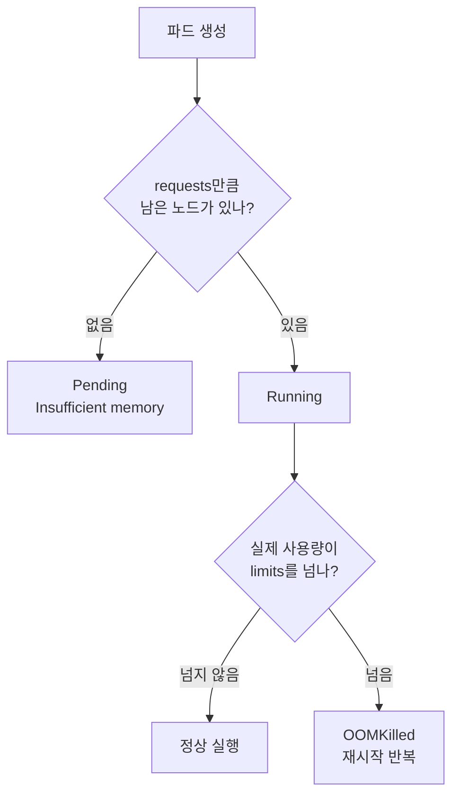
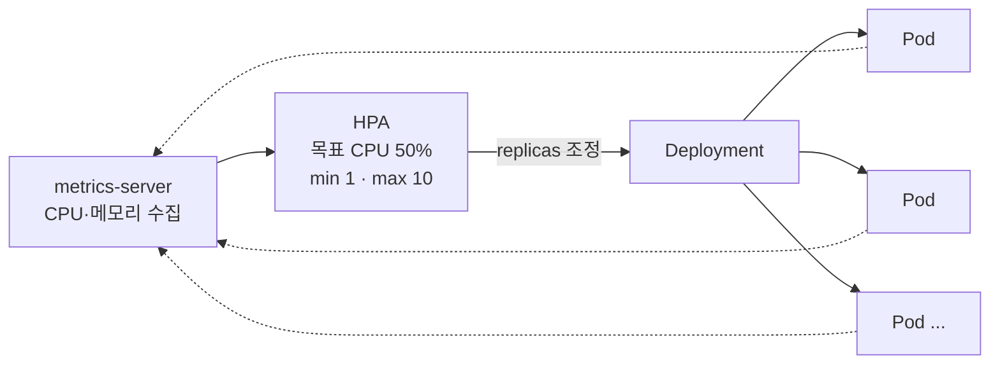
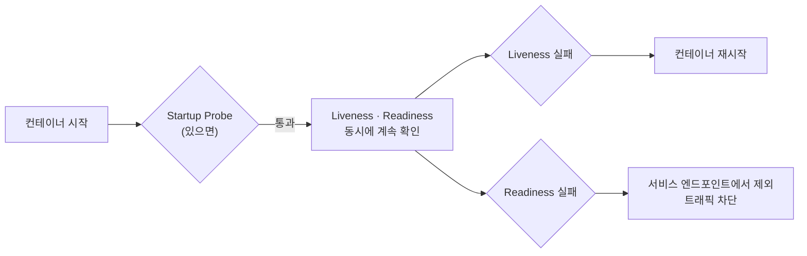
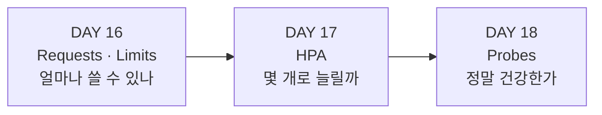

# Week 11 — DAY 16, 17, 18 학습 정리

정리: 김민성
강의: Tech Tutorials with Piyush — CKA Full Course
범위: DAY 16 (Resource Requests & Limits) / DAY 17 (Autoscaling, HPA) / DAY 18 (Health Probes)

이번 주는 **실행 중인 파드를 어떻게 건강하게 유지하는가**에 관한 세 강의다. 파드가 자원을 얼마나 쓸 수 있는지(requests, limits), 부하에 맞춰 파드 수를 어떻게 늘리고 줄이는지(HPA), 파드 안의 앱이 정말 살아 있고 요청을 받을 준비가 됐는지 어떻게 확인하는지(probe)를 다룬다.

---

## DAY 16 — Resource Requests & Limits

### 왜 필요한가

스케줄러는 taint, nodeSelector, affinity 말고도 **자원**을 보고 노드를 고른다.

노드 두 대가 각각 CPU 4개, 메모리 4GB이고, 파드 하나가 CPU 1개와 메모리 1GB를 쓴다고 하자.

- 스케줄러는 자원이 남은 노드에 파드를 하나씩 배치한다
- 첫 번째 노드가 가득 차면 다음 노드로 간다
- 두 노드가 모두 가득 차면 새 파드는 **어디에도 갈 수 없어서 Pending**이 된다. 이벤트에는 `Insufficient cpu`, `Insufficient memory` 같은 메시지가 남는다

이 계산을 하려면 파드가 **얼마를 요구하는지** 알려줘야 한다. 그게 requests와 limits다.

### 아무것도 지정하지 않으면

노드 한 대(CPU 4, 메모리 4GB)에 파드 하나가 떠 있다. 원래 CPU 1, 메모리 1GB면 충분한 앱인데 **requests와 limits를 지정하지 않았다.**

부하가 늘면 이 파드는 노드의 CPU와 메모리를 **전부** 가져갈 수 있다.

| 자원 | 한계를 넘으면 |
| --- | --- |
| **CPU** | **스로틀링(throttling)**. 느려지지만 죽지는 않는다 |
| **메모리** | **OOM(Out Of Memory)**. 프로세스가 강제 종료된다 |

더 큰 문제는 **노드까지 메모리가 바닥난다**는 점이다. 노드의 OOM killer가 동작하면서 **같은 노드의 다른 파드들까지 죽을 수 있다.** 파드 하나 때문에 노드 전체가 흔들린다.

limits를 걸면 상한을 넘은 **그 파드만** 죽는다. 노드와 다른 파드는 안전하다.

### Metrics Server

노드와 파드의 **CPU·메모리 사용량을 수집해서 노출**하는 애드온이다. 이후 배울 HPA, VPA가 이 데이터를 보고 동작한다.

```bash
kubectl apply -f metrics-server.yaml
kubectl get pods -n kube-system | grep metrics-server

kubectl top node
kubectl top pod <pod> -n <namespace>
```

metrics-server가 없으면 `kubectl top` 은 동작하지 않는다.

### 매니페스트 작성법

`resources` 는 **컨테이너의 자원**이므로 `containers` 아래에 둔다.

```yaml
apiVersion: v1
kind: Pod
metadata:
  name: memory-demo
  namespace: mem-example        # 네임스페이스를 YAML에 직접 지정할 수도 있다
spec:
  containers:
    - name: memory-demo-ctr
      image: polinux/stress
      resources:
        requests:
          memory: "100Mi"       # 최소 보장량 (스케줄링 기준)
        limits:
          memory: "200Mi"       # 최대 사용량
      command: ["stress"]
      args: ["--vm", "1", "--vm-bytes", "150M", "--vm-hang", "1"]
```

| 항목 | 의미 |
| --- | --- |
| **requests** | 파드가 **시작할 때 확보하는 양**. 스케줄러가 이 값을 보고 노드를 고른다 |
| **limits** | 파드가 **쓸 수 있는 최대치**. 메모리가 이걸 넘으면 OOMKilled |

`polinux/stress` 는 **부하 테스트용 이미지**다. `--vm-bytes` 로 실제로 메모리를 얼마나 쓸지 지정한다.

단위도 알아두자.

| 표기 | 의미 |
| --- | --- |
| `Mi`, `Gi` | 2진 단위. 1Mi = 1024 × 1024 바이트. MB와 거의 같지만 조금 크다 |
| `M`, `G` | 10진 단위 |
| CPU `200m` | 밀리코어. **1000m = CPU 1개**. 200m는 0.2 CPU |

네임스페이스를 지정하는 방법은 두 가지다. 명령에 `-n` 을 붙이거나, YAML의 `metadata.namespace` 에 적는다.

### 실험 — 세 가지 경우



**1. 한도 안에서 사용** — requests 100Mi, limits 200Mi, 실제 사용 150M

```bash
kubectl get pods -n mem-example      # Running
kubectl top pod memory-demo -n mem-example
# MEMORY 약 150Mi
```

limits 안이므로 정상 실행된다. CPU는 따로 제한하지 않아서 꽤 많이 쓰는 것으로 나왔다.

**2. 한도를 넘어 사용** — requests 50Mi, limits 100Mi, 실제 사용 250M

```bash
kubectl get pods -n mem-example
# memory-demo-2   0/1   OOMKilled

kubectl describe pod memory-demo-2 -n mem-example
# Reason: OOMKilled
```

limits를 넘어서 **파드가 죽었다.** 노드는 무사하다. 강사 설명대로, 노드 전체가 무너지는 것보다 파드 하나를 죽이고 requests와 limits를 조정하는 편이 낫다. `kubectl top` 으로 조회해도 메트릭이 나오지 않는다.

**3. 노드보다 큰 값을 요청** — requests와 limits를 1000Gi로 설정

```bash
kubectl get pods -n mem-example
# memory-demo-3   0/1   Pending

kubectl describe pod memory-demo-3 -n mem-example
# 0/3 nodes are available: 1 node(s) had untolerated taint ...,
#   2 Insufficient memory.
```

**아예 스케줄되지 않는다.** 1000Gi를 줄 수 있는 노드가 없기 때문이다.

### 정리

- **requests는 스케줄링 시점**에 쓰인다. 노드에 그만큼 여유가 없으면 Pending
- **limits는 실행 중**에 쓰인다. 메모리가 넘으면 OOMKilled, CPU가 넘으면 스로틀링
- 2번 실험은 메모리 누수나 갑작스러운 트래픽 증가로 메모리를 다 써버리는 **실제 장애 상황을 흉내 낸 것**이다

---

## DAY 17 — Autoscaling

> 강사 언급: 오토스케일링은 **CKA 시험 범위가 아니다.** 하지만 쿠버네티스를 제대로 배우려면 꼭 알아야 할 주제라 포함했다.

### 스케일링이란

**수요에 맞춰 서버나 워크로드를 바꾸는 것**이다. 지금까지는 전부 수동이었다.

- Deployment의 `replicas` 를 직접 바꿈
- 노드를 직접 추가함

하지만 운영 환경을 24시간 지켜볼 수는 없고, 파드가 수천 개라면 수동은 불가능하다. 그래서 **자원 사용량이나 부하에 따라 자동으로** 늘리고 줄이는 오토스케일링이 필요하다.

### 수평 스케일링 vs 수직 스케일링

| | 수평 (Horizontal) | 수직 (Vertical) |
| --- | --- | --- |
| 방법 | **같은 파드를 더 추가** | **파드를 더 큰 것으로 교체** |
| 다른 이름 | scale out / scale in | scale up / scale down |
| 재시작 | 필요 없음 | **필요함** |
| 적합한 앱 | 중단되면 안 되는 앱 | 잠깐 중단돼도 괜찮은 앱 |

**수평 확장(HPA)** 은 예를 들어 "CPU 평균 사용률이 60%를 넘으면 파드를 하나씩 추가하라"는 식으로 동작한다. 사용자가 늘면 파드가 늘고, 줄면 다시 줄어든다.

**수직 확장(VPA)** 은 CPU 1, 메모리 1GB짜리 파드를 CPU 10, 메모리 10GB짜리로 키운다. 대신 **재시작이 필요하므로** 다운타임이 허용되는, 미션 크리티컬하지 않은 앱에 쓴다.

클라우드에서도 개념은 같다.

- 수평: AWS **Auto Scaling Group**이 EC2 인스턴스 수를 늘리고 줄인다
- 수직: EC2를 더 큰 인스턴스 타입으로 교체한다

### 쿠버네티스의 오토스케일링 도구

수평/수직 두 방향을 **워크로드(파드)** 와 **인프라(노드)** 두 대상에 적용하면 네 가지가 나온다.

| | 워크로드 (파드) | 인프라 (노드) |
| --- | --- | --- |
| **수평** | **HPA** (Horizontal Pod Autoscaler) | **Cluster Autoscaler** |
| **수직** | **VPA** (Vertical Pod Autoscaler) | **Node Auto-Provisioning** |

이 중 **쿠버네티스에 기본으로 들어 있는 건 HPA뿐**이다.

- **HPA**: 기본 내장. 단 **metrics-server**가 있어야 동작한다
- **VPA**: GitHub의 별도 프로젝트라 따로 설치해야 한다
- **Cluster Autoscaler, Node Auto-Provisioning**: 주로 **EKS, AKS, GKE 같은 클라우드 매니지드 서비스**에서 제공한다. kind나 minikube 같은 로컬 환경에서는 노드를 늘릴 수 없다

그 밖의 방식도 있다.

- **이벤트 기반**: CPU·메모리가 아니라 특정 이벤트(예: 특정 에러 코드가 많이 발생)에 반응해 확장한다. 대표 도구가 CNCF 프로젝트인 **KEDA**다
- **스케줄 기반**: 정해진 시간에 늘리고 줄인다

### HPA 동작 구조



HPA는 **기본 15초마다** 워크로드의 사용률을 확인한다(이 주기는 controller manager에서 설정한다). 평균 사용률이 목표를 넘으면 Deployment의 `replicas` 를 늘리고, 내려가면 줄인다.

### 실습

> 녹화 중에 CKA 시험 환경이 1.30으로 올라가서 강사도 클러스터를 1.30으로 업그레이드했다. 시험과 같은 버전으로 실습하는 게 좋다.

**1. 테스트용 앱 배포**

한 YAML 파일에 오브젝트 여러 개를 넣을 때는 **`---` 로 구분**한다.

```yaml
apiVersion: apps/v1
kind: Deployment
metadata:
  name: php-apache
spec:
  selector:
    matchLabels:
      run: php-apache
  template:
    metadata:
      labels:
        run: php-apache
    spec:
      containers:
        - name: php-apache
          image: registry.k8s.io/hpa-example
          ports:
            - containerPort: 80
          resources:
            limits:
              cpu: 500m
            requests:
              cpu: 200m
---
apiVersion: v1
kind: Service
metadata:
  name: php-apache
spec:
  ports:
    - port: 80
  selector:
    run: php-apache
```

`replicas` 를 지정하지 않았으므로 파드는 1개로 시작한다.

**HPA가 CPU 사용률(%)을 계산하려면 CPU requests가 반드시 있어야 한다.** 사용률은 "requests 대비 실제 사용량"이기 때문이다.

**2. HPA 생성**

```bash
kubectl autoscale deployment php-apache --cpu-percent=50 --min=1 --max=10
kubectl get hpa
```

```
NAME         REFERENCE               TARGETS         MINPODS   MAXPODS   REPLICAS
php-apache   Deployment/php-apache   <unknown>/50%   1         10        1
```

처음에는 메트릭이 수집되지 않아 `<unknown>` 이다. 잠시 뒤 `1%/50%` 처럼 바뀐다.

**3. 부하 발생 (별도 터미널)**

```bash
kubectl run -i --tty load-generator --rm --image=busybox:1.28 --restart=Never \
  -- /bin/sh -c "while sleep 0.01; do wget -q -O- http://php-apache; done"
```

busybox 컨테이너가 서비스에 요청을 계속 보낸다. 화면에 `OK!` 가 반복 출력된다.

**4. 관찰**

```bash
kubectl get hpa --watch
kubectl get pods
```

CPU 사용률이 목표 50%를 크게 넘어 160%, 117% 등으로 올라가자 레플리카가 **5개, 7개로 늘어났다.**

**5. 부하 중단**

부하 생성기를 `Ctrl + C` 로 멈추면 사용률은 떨어지지만 **파드가 즉시 줄어들지는 않는다.** 몇 분에 걸쳐 천천히 줄어들어 `min` 으로 지정한 1개까지 돌아간다.

> 보충: 줄어들 때 느린 건 의도된 동작이다. 부하가 잠깐 떨어졌다가 다시 오르는 경우 파드를 줄였다 늘렸다를 반복하지 않도록, 축소할 때는 기본 5분의 안정화 기간을 둔다.

---

## DAY 18 — Health Probes

### Probe란

**시스템을 계속 감시하면서, 건강하지 않으면 필요한 조치를 하는 장치**다. 건강 상태를 회복하거나, 상태를 확인하거나, 정상 동작을 보장하는 것이 목적이다.

쿠버네티스의 헬스 프로브는 **앱이 실패하면 자동으로 회복되고, 사용자는 영향을 받지 않도록** 만드는 게 목표다.

### 프로브 세 종류

| 프로브 | 확인하는 것 | 실패하면 |
| --- | --- | --- |
| **Liveness** | 앱이 **살아 있는가** | **컨테이너를 재시작** |
| **Readiness** | 앱이 **요청을 받을 준비가 됐는가** | **트래픽을 보내지 않음** (재시작 안 함) |
| **Startup** | 앱이 **시작을 마쳤는가** | 시작 완료 전까지 다른 프로브를 보류 |

**Liveness Probe**: 일시적인 네트워크 오류나 앱 오류처럼 **재시작만 하면 회복되는 문제**에 대응한다. 재시작으로도 해결되지 않으면 알림을 받고 원인을 찾을 시간을 벌어준다.

**Readiness Probe**: 로드밸런서 뒤에 파드 3개가 있다고 하자. 어떤 앱은 완전히 뜨는 데 20~30초가 걸린다. 그동안 트래픽이 가면 사용자는 **5xx 에러**를 받는다. readiness probe를 통과한 파드에만 트래픽을 보내서 이걸 막는다.

**Startup Probe**: 시작이 아주 오래 걸리는 **느린 앱이나 레거시 앱**용이다. 예를 들어 5분을 기다려야 한다면 startup probe가 먼저 동작하고, **통과한 뒤에야 liveness와 readiness가 활성화**된다.



> 실무에서는 거의 모든 앱에 **liveness와 readiness를 함께** 거는 것이 모범 사례다.

### 확인 방식 세 가지

세 종류의 프로브는 각각 아래 방식 중 하나로 확인한다.

| 방식 | 동작 | 성공 기준 |
| --- | --- | --- |
| **exec** | 컨테이너 안에서 **명령 실행** | 종료 코드 0 |
| **httpGet** | 지정한 경로로 **HTTP GET 요청** | 응답 코드 200~399 |
| **tcpSocket** | 지정한 포트로 **TCP 연결 시도** | 연결 성공 |

### 실습 1 — exec 방식 liveness

```yaml
apiVersion: v1
kind: Pod
metadata:
  name: liveness-exec
spec:
  containers:
    - name: liveness
      image: busybox
      args:
        - /bin/sh
        - -c
        - touch /tmp/healthy; sleep 30; rm -f /tmp/healthy; sleep 600
      livenessProbe:
        exec:
          command:
            - cat
            - /tmp/healthy
        initialDelaySeconds: 5
        periodSeconds: 5
```

프로브도 **컨테이너의 속성**이라 `containers` 아래에 둔다. 들여쓰기를 주의하자.

컨테이너가 하는 일은 이렇다.

1. `/tmp/healthy` 파일을 만든다
2. 30초 기다린다
3. 파일을 지운다
4. 600초(10분) 기다린다

프로브는 `cat /tmp/healthy` 를 실행한다. 처음 30초는 파일이 있어서 성공한다. 파일이 지워진 뒤에는 `cat` 이 **0이 아닌 종료 코드**를 반환해서 실패하고, **컨테이너가 재시작된다.** 유닉스에서는 0이 성공이고 1, 127 같은 나머지 값은 전부 실패다.

두 설정값의 차이가 중요하다.

| 설정 | 의미 |
| --- | --- |
| `initialDelaySeconds` | **첫 번째 검사 전에 기다리는 시간**. 앱이 부팅할 시간을 준다. 운영 환경에서는 보통 10~30초 |
| `periodSeconds` | **검사 간격**. 이후 몇 초마다 검사할지 |

```bash
kubectl apply -f liveness-exec.yaml
kubectl get pods -w          # 30여 초 뒤 RESTARTS가 1로 증가
kubectl describe pod liveness-exec
```

```
Warning  Unhealthy  Liveness probe failed: cat: can't open '/tmp/healthy': No such file or directory
Normal   Killing    Container liveness failed liveness probe, will be restarted
```

재시작되면 다시 파일을 만들고 30초 뒤 또 실패하므로, 재시작이 계속 반복된다.

### 실습 2 — httpGet 방식 liveness

```yaml
livenessProbe:
  httpGet:
    path: /healthz
    port: 8080
  initialDelaySeconds: 3
  periodSeconds: 3
```

`exec` 대신 `httpGet` 을 쓰고 경로와 포트를 지정한다. 나머지 구조는 같다.

적용하면 처음에는 Running이지만 곧 **500 에러로 프로브가 실패하면서 재시작이 반복**되고, 결국 **CrashLoopBackOff**가 된다.

```
Warning  Unhealthy  Liveness probe failed: HTTP probe failed with statuscode: 500
```

강사는 컨테이너에 들어가 `/healthz` 파일을 만들어 봤지만 해결되지 않았다. httpGet은 **파일이 있는지 보는 게 아니라 HTTP 응답 코드를 보는 것**이기 때문이다.

> 보충: 쿠버네티스 공식 문서의 이 예제 이미지는 **시작 후 10초까지만 200을 반환하고 그 뒤로는 500을 반환하도록** 일부러 만들어져 있다. liveness probe가 재시작하는 모습을 보여주기 위한 예제라 실패가 정상이다.

### 실습 3 — tcpSocket 방식 liveness

```yaml
livenessProbe:
  tcpSocket:
    port: 8080
  initialDelaySeconds: 15
  periodSeconds: 10
```

지정한 포트로 TCP 연결을 시도해서 열려 있으면 성공이다. 앱이 8080에서 리스닝하고 있으니 재시작 없이 정상 실행된다.

검사 포트를 **3000**으로 바꾸면(앱은 여전히 8080에서 동작) 연결이 거부되어 재시작된다.

```
Warning  Unhealthy  Liveness probe failed: dial tcp ...:3000: connect: connection refused
```

### 실행 중인 파드의 프로브는 바꿀 수 없다

프로브를 고치고 다시 apply하면 에러가 난다.

```
The Pod "tcp-pod" is invalid: spec: Forbidden: pod updates may not change fields other than ...
```

파드는 생성 후 대부분의 필드를 바꿀 수 없다. `--force` 를 붙이면 **파드를 지우고 다시 만든다.**

```bash
kubectl apply -f liveness-tcp.yaml --force
```

### 지정하지 않은 기본값

`kubectl get pod <pod> -o yaml` 로 보면 직접 쓰지 않은 필드가 들어 있다.

| 필드 | 기본값 | 의미 |
| --- | --- | --- |
| `failureThreshold` | **3** | **연속 3번 실패해야** 실패로 판정. 한 번 실패로 바로 재시작하지 않는다 |
| `successThreshold` | **1** | **1번 성공하면** 정상으로 판정 |
| `timeoutSeconds` | 1 | 응답을 기다리는 시간 |

### 자동으로 붙는 toleration

같은 YAML을 보면 **추가한 적 없는 toleration**도 있다.

```yaml
tolerations:
  - key: node.kubernetes.io/not-ready
    operator: Exists
    effect: NoExecute
    tolerationSeconds: 300
  - key: node.kubernetes.io/unreachable
    operator: Exists
    effect: NoExecute
    tolerationSeconds: 300
```

쿠버네티스가 자동으로 붙인 것이다. 노드가 **NotReady거나 연결이 끊기면** 노드에 이 taint가 붙고, 파드는 **300초 동안만 버티다가 쫓겨나 다른 노드로 옮겨진다.** 건강한 노드에서만 파드가 돌도록 하는 고가용성 장치다. DAY 15에서 본 `NoExecute` 와 `tolerationSeconds` 가 실제로 쓰이는 사례다.

### Readiness Probe

문법은 liveness와 **똑같고**, 키 이름만 `readinessProbe` 다. `livenessProbe` 와 **같은 레벨**에 둔다.

```yaml
livenessProbe:
  httpGet:
    path: /healthz
    port: 8080
  initialDelaySeconds: 3
  periodSeconds: 3
readinessProbe:
  httpGet:
    path: /healthz
    port: 8080
  initialDelaySeconds: 3
  periodSeconds: 3
```

```bash
kubectl get pods
# hello   0/1   Running   ← Running이지만 READY 0/1
```

readiness가 실패하면 **STATUS는 Running인데 READY는 0/1**이다. 컨테이너는 떠 있지만 트래픽을 받지 않는 상태다.

강사 실습에서는 결국 CrashLoopBackOff가 되었는데, 이건 **같은 파드에 걸린 liveness probe가 실패했기 때문**이다. readiness probe 자체는 재시작을 일으키지 않는다.

### Liveness와 Readiness 비교

| | Liveness | Readiness |
| --- | --- | --- |
| 질문 | 살아 있는가 | 요청을 받을 수 있는가 |
| 실패 시 | **재시작** | **트래픽 차단** (재시작 없음) |
| 파드 상태 | RESTARTS 증가, CrashLoopBackOff | READY 0/1 |
| 문법 | 동일 | 동일 |

---

## 세 강의 정리



세 강의는 서로 연결된다.

- DAY 16에서 설치한 **metrics-server**가 DAY 17 HPA의 판단 근거가 된다
- HPA가 CPU 사용률(%)을 계산하려면 DAY 16의 **CPU requests**가 반드시 있어야 한다
- HPA가 파드를 늘려도, 새 파드가 아직 준비되지 않았다면 DAY 18의 **readiness probe**가 트래픽을 막아준다

| 주제 | 문제 | 해결 |
| --- | --- | --- |
| Requests | 스케줄러가 노드 여유를 모름 | 최소 보장량을 알려 배치 기준 제공 |
| Limits | 파드 하나가 노드 자원을 독차지 | 상한을 넘으면 그 파드만 종료 |
| HPA | 부하 변화에 수동 대응 불가 | 사용률에 따라 파드 수 자동 조정 |
| Liveness | 앱이 멈췄는데 아무도 모름 | 실패 시 자동 재시작 |
| Readiness | 준비 안 된 파드에 트래픽 유입 | 준비될 때까지 트래픽 차단 |
| Startup | 느린 앱이 시작 중에 죽음 | 시작 완료까지 다른 프로브 보류 |

### 자주 쓰는 명령어

```bash
# 메트릭
kubectl top node
kubectl top pod <pod> -n <ns>

# HPA
kubectl autoscale deployment <name> --cpu-percent=50 --min=1 --max=10
kubectl get hpa --watch

# 상태 확인
kubectl get pods -w
kubectl describe pod <pod>              # OOMKilled, Unhealthy 이벤트
kubectl get pod <pod> -o yaml           # 기본값, 자동 toleration 확인

# 파드 필드 변경 (삭제 후 재생성)
kubectl apply -f <file>.yaml --force
```
